# FujiKon

FujiKon 是一个 Android 端的尼康 Picture Control 预设工具：导入 `.NCP` / `.NP3` 文件，批量套用到手机相册照片，套用后可继续通过 Lightroom 风格调节面板、RGB 色调曲线微调，自由移动/缩放的裁剪与纠偏重新构图，以及点选焦点的镜头模糊制造景深，长按对比原图、双指缩放查看细节，并尽量以原图尺寸导出到相册、保留相机 EXIF 信息；直方图卡片提供本机**一键优化**自动校正影调；也可以输入自定义提示词调用 Agnes 图像大模型进行**一键 AI 修图**，或点「生成提示词」让 Agnes 3.0 Flash 文本大模型分析画面后自动填词。

解析、调色与渲染都在本机 CPU 完成，**「一键优化」完全离线、不联网、不需要密钥**；1.6.23 起「选择主体 / 选择天空 / 选择颜色范围」的**端侧 AI 语义分割同样在本机运行、不联网、不上传照片**（TFLite 模型随 APK 打包，无需密钥）。在线预设库只读取公开接口，不会上传照片或本地预设；**只有「一键 AI 修图」与「生成提示词」会把当前预览图发送给 Agnes**（分别给图像大模型与文本大模型；需要你先在「设置」里录入 API 密钥，可回显、明文查看并验证），「验证密钥」只发送一句测试提示词、不上传照片，详见下文。

## 功能

- 导入尼康 `.NCP` / `.NP3` 预设（SAF 文件选择器，支持多选；也可以从文件管理器直接用 FujiKon 打开）
- 从 nikonpc.com 在线浏览全部社区 Picture Control，支持单个导入和一键全部导入，自动去重并缓存下载内容
- 连接尼康云创（Nikon Imaging Cloud）公开色彩方案库，列表附带创作者说明摘要，可单个导入并自动去重；无需尼康账号
- 预设管理：收藏、重命名、备注、删除、恢复内置示例
- 解析文件内的 256 点色调曲线、锐化/清晰度/中间锐度、对比度、亮度、饱和度、色相、高光/阴影/白色/黑色、单色滤镜与色调
- 解析 NP3 的 Color Blender（8 色相带）与 Color Grading（高光/中间调/阴影、混合、平衡）
- 从系统相册按相册筛选、批量勾选照片
- 实时预览：长按查看原图，双指缩放/拖动，双击快速放大
- 套用预设后可实时调节色温、色调、自然饱和度、曝光度、对比度、高光、阴影、白色色阶、黑色色阶、纹理、清晰度、去朦胧；按“光线 / 颜色 / 细节”分组，双击滑块归零
- 预设列表提供“无（保留原图）”选项：不套用任何 Picture Control，仍可继续裁剪、HSL 调色、影调、滤镜和手动调节
- 8 色带 HSL 混色器（红、橙、黄、绿、青、蓝、紫、洋红），每带独立色相、饱和度、明度；并在调节面板内提供“影调”曲线编辑
- 非破坏性自由裁剪：在裁剪框内拖动移动画面、双指缩放、拖动四角改大小，支持自由、原图、1:1、4:3、3:4、3:2、2:3、16:9、9:16 比例，并可顺时针旋转（0/90/180/270°）与纠偏（±45°）；旋转 / 纠偏时自动放大避免空白角，预览与导出使用同一裁切区域。
- Lightroom 风格镜头模糊：全屏编辑器中点按或拖动照片选择焦点，可调模糊强度、聚焦范围、边缘过渡与散景高光，焦点区域保持清晰、四周渐进虚化；“自动对焦”按画面细节自动挑选焦点，参数随预设保存并用于批量导出。
- 人像美颜（对标像素蛋糕/主流修图 App）：肤色识别后磨皮、美白、红润、立体四个滑杆，另附“自然 / 清透 / 奶油肌 / 日系 / 质感”风格预设；只作用于肤色区域，五官与发丝边缘自动保留细节，背景不受影响，参数随预设保存并用于批量导出。
- 内置富士、理光、徕卡风光滤镜与人像系列滤镜，强度可调，并与预设、HSL、调节参数叠加
- **「写真」人像复合滤镜**：按户外写真样张量化调制，但**不做抬黑／褪色／全局降饱和**——黑位扎实、保留对比与皮肤微纹理，只轻抬暗部、轻压高光留住白裙层次。一个滤镜 chip 同时应用定向 HSL（肤色白皙粉润、绿植去黄偏青）、肤色掩码内的轻磨皮／美白／红润，以及强立体回补与正向微纹理来保住质感（不用负清晰度／纹理糊脸），柔焦只留极弱负 clarity；面板内附可折叠的白色「用法」说明。强度 0% 等同原图、100% 为完整配方，数值越低越接近原片；用户手动调整的 HSL／人像／清晰度等图层优先，不会被滤镜覆盖或重复叠加。预设只保存滤镜 id 与强度两项，不新增持久化字段，旧版本预设仍可正常读取
- 套用预设后可调整 Lightroom 风格色调曲线：RGB 主通道与红 / 绿 / 蓝分通道各自独立编辑，面板顶部切换通道、曲线颜色随通道变化；点击空白加点、拖动控制点、双击删除；近乎透明的面板让照片保持可见，拖动过程中持续刷新预览
- 将当前调节、HSL、人像美颜、裁剪、镜头模糊、滤镜、RGB 与分通道曲线及预设参数保存为预设列表中的新副本，不修改原始 NCP/NP3 文件
- 批量导出：JPEG（最高画质、保留 EXIF）或 PNG（无损、不写 EXIF）；一次导出全部所选照片，但每张使用自己单独的调色结果
- **逐张独立修图（1.6.28）**：相册选好照片 → 左下角选预设 → 点「下一步」，所选预设**一次性批量套用到全部所选照片**作为共同起点；进入编辑页后即为**逐张修图**，换预设 / 调参数 / 曲线 / 蒙版 / 一键优化只作用于当前预览的这一张，切换照片不会把上一张的修改带过去。每张照片有**自己独立的操作历史栈**（回退 / 重做 / 历史面板跳转都只针对当前照片），历史面板标注「当前照片 · 历史步骤」；批量导出时各张用各自的最终效果，而不是同一份效果套全批
- **复制 / 粘贴效果（1.6.29）**：右上角三点「更多」菜单可「复制效果」（记住当前照片的完整效果：预设 + 主/分通道曲线 + 全部调节参数，含裁剪、镜头模糊、蒙版图层），再到另一张照片「粘贴效果」一次性套用；未复制时粘贴按钮置灰不可点，重复复制以最新一次为准，剪贴板跨照片保留，可连续贴多张。粘贴是逐张独立且可撤销的编辑，AI 修图成品图不参与复制。底部预设 / 调节 / 裁剪 / 模糊 / 曲线 / 蒙版 / AI 改为**一行可左右滑动**，导出按钮移入「更多」菜单
- 显示 RGB 直方图，并根据当前直方图分布动态给出修图提示，同时列出 **Top 3 本机推荐预设**（可解释、离线、点一下即套用）；**分区说明**与推荐预设合并为一个**可折叠面板**，文字统一为白色并带柔和阴影，点右侧下拉 / 收起箭头即可显示或隐藏（1.6.25 起默认收起，无内容时自动隐藏图标）
- **局部调整 / 蒙版**：几何选区（控制点、线性渐变、径向渐变、画笔）+ **三种内容感知选区**——「选择主体」「选择天空」「选择颜色范围」，可叠加最多 12 层，每层独立调亮度 / 对比度 / 高光 / 阴影 / 饱和度 / 色温 / 清晰度与图层强度，支持羽化、反转、启停与图层增删；坐标归一化，预览与原图尺寸导出共用同一套掩码
- **内容感知选区（端侧 AI 语义分割，对标 Lightroom / 美图秀秀）**：切换工具即在**未编辑原图**上由两个本机 TFLite 语义分割模型自动识别，选区在编辑器中以**红色半透明阴影**实时可见（Lightroom 式蒙版叠加，1.6.24 起由琥珀色改为红色）；**全部本机运行、不联网、不上传照片、无需密钥**，模型随 APK 打包（约 5 MB）。1.6.23 起以真实 AI 分割替代旧的纯启发式识别，显著提升识别精度。1.6.25 起**线性蒙版**的两端点之间条带也填充沿渐变方向的红色半透明阴影，四类几何蒙版（控制点 / 线性 / 径向 / 画笔）作用域显示完全一致。
  - **选择主体**：`seg_subject_voc.tflite`（DeepLabV3 / PASCAL VOC，float32 257×257，21 类）以「1 − 背景 softmax」得到物体概率，覆盖人物、猫狗、车辆、自行车等 20 类主体，取代旧的「中心圆盘」启发式；点照片可在多个对象间切换选中目标；低置信度边界再由前景 / 背景颜色、肤色、边缘、纹理与区域生长等本机 CV 线索修正。
  - **选择天空**：`seg_sky_ade20k.tflite`（ADE20K 量化场景分割，uint8 512×512）以语义 `sky` 类识别**蓝天、晚霞、阴天与云层**，不再依赖「顶边蓝色扩散」，能正确区分水面与蓝色衣物；模型不可用时保留旧的顶边蓝色连通域降级路径。
  - **选择颜色范围**：色差从 HSL / RGB 距离升级为 **OKLab 感知色差（ΔE-like）**，解决相邻色、暗部色、高饱和色误选；点照片取主色，用「＋取色 / －排除色」补充或排除多个取样点，配合色相范围 / 颜色容差 / 排除灰阶 / 边缘羽化精细控制。
  - **边缘对齐**：粗粒度网络掩码经**引导滤波（guided filter）**以原图亮度为引导对齐真实图像边缘，消除「贴纸感」轮廓；并提供收缩 / 扩展边缘、边缘平滑与智能边缘对齐开关。
  - **对标精修交互**：参数面板提供「＋添加 / －擦除」笔刷（在照片上涂抹增减选区）、重新识别（清缓存重算）、显示 / 隐藏选区叠加；红色阴影为选中区域，点图重定位 / 取色，双指缩放旋转。所有精修随预设持久化，旧版本预设读到未知字段安全取默认值。
  - 三类选区只持久化「生成参数 + 种子点 + 精修笔刷 / 取样点」，渲染时由原图重算像素级软网格（最长边 ≤384），不存浮点掩码，预览与导出完全一致。AI 推理结果按**分辨率无关指纹**缓存，UI 缩略图叠加与全尺寸导出复用同一份推理；模型未加载 / 加载失败 / 纯 JVM 测试环境时，自动、完整地降级为旧的 CPU 启发式算法，界面如实标注当前识别引擎状态（「端侧 AI 语义分割」或「本机智能识别（自动降级）」）。
- **画质算子**：独立边缘保持降噪（双边滤波，作用于锐化之前）、确定性胶片颗粒、可调暗角、Lightroom 风格**点颜色**（只偏移选中的那一档颜色，近灰色像素不受影响）
- **16bit 等效高精度中间缓冲**：新增算子的 RGB 全程以浮点计算，每像素只量化一次，叠加多层蒙版不会在暗部渐变产生色带；渲染后端做成可插拔接口 `RenderBackend`（当前仅 `CpuRenderBackend`）
- **蒙版橡皮擦（图层级，全类型通用）**：1.6.26 起任意蒙版（控制点 / 线性 / 径向 / 画笔 / 选择主体 / 选择天空 / 选择颜色范围）都可在参数区开启「橡皮擦」，在照片上单指涂抹即可把该处从**当前图层**的作用域中去除；支持橡皮擦大小 / 羽化、多笔叠加、笔数显示与一键「清除擦除」，红色阴影同步显示被挖空的区域，白色圆圈跟随笔尖。擦除笔迹随预设 / 历史 / 导出持久化，预览与导出完全一致（在 `LocalMaskRenderer.prepare` 的最终网格上统一应用 `applyEraser`）；旧预设无 `eraser` 字段时安全回退为空列表。
- **一键优化**（本机，对标 Lightroom「自动」/ 美图秀秀「一键美化」）：**真正一键**——点一下内部自动循环「渲染 → 实测 → 修正参数 → 再验证」，直到真实渲染像素满足**无死白 / 不死黑，且保留亮部光感、色彩与层次**的最优标准；用实测像素直方图闭环求解一组可撤销、可继续手动微调的调节参数，不联网、不需密钥、不改动原图；配色与质感严格按「日常户外抓拍」四步配方（通透感 / 青蓝绿配柔黄 / 细节保留 / 微柔光收尾），并在全局曲线之上叠加**分区自适应**的局部调整层（见下节）。1.6.25 起直方图卡片的「分区与推荐」面板**默认收起**，「一键优化」按钮底色由浅黄改为**全透明**（仅留极淡中性描边），预设 / 调节 / 曲线 / 蒙版四个子页面统一加入淡入 + 上滑的进出过渡动画
- **生成提示词**：AI 修图弹窗「快捷灵感」下方一键把当前预览图交给 Agnes 3.0 Flash 文本大模型分析，自动填入可继续修改的中文优化提示词；模型不可用时自动降级为本机图像分析并如实标注
- **一键 AI 修图**：输入任意自定义提示词，调用 Agnes 最新 `agnes-image-2.5-flash` 图像大模型对当前预览图做图生图编辑，结果作为最终照片直接预览与导出；未配置 API 密钥时会在开始修图时弹窗提示跳转「设置」录入并保存，设置页可回显/明文查看已存密钥并「验证密钥」
- 导出到 `Pictures/<相册名>`，原图尺寸（受设备内存限制时自动降到可处理的最大尺寸）
- 深色界面，适配 Android 13/14/15 的照片权限（含“仅选择部分照片”）


---

## App 功能截图（v1.4.0）

### 完整流程图文版

**1 · 首页**
- 点击“从 nikonpc 下载”进入在线预设列表  
  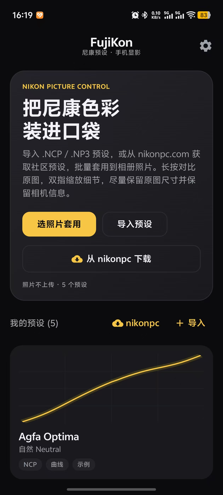


---

**2 · 在线预设列表**
- nikonpc.com 公开预设列表，可选择单个或全部导入  
  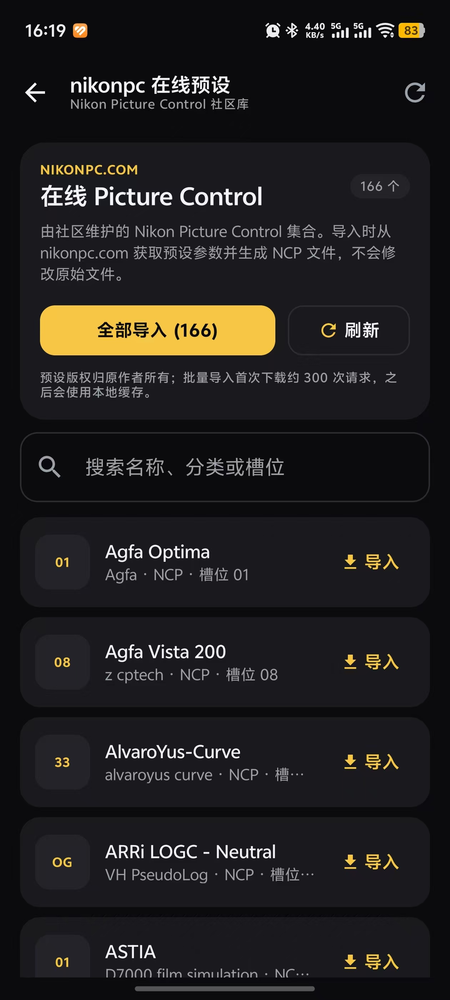


---

**3 · 预设列表**
- 导入完成后显示在首页预设列表，曲线图展示 
  <div style="display: flex; justify-content: center; gap: 10px;">
    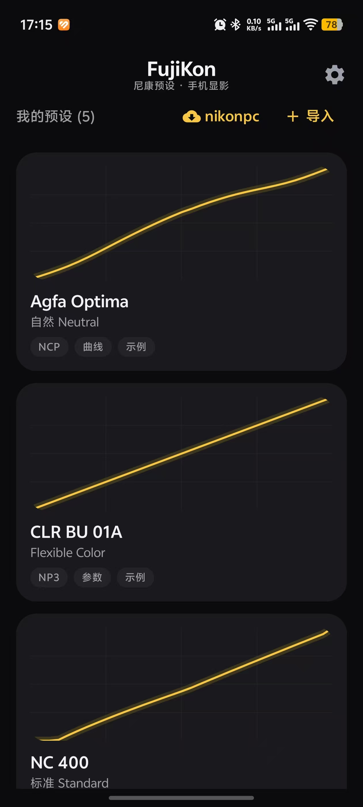
    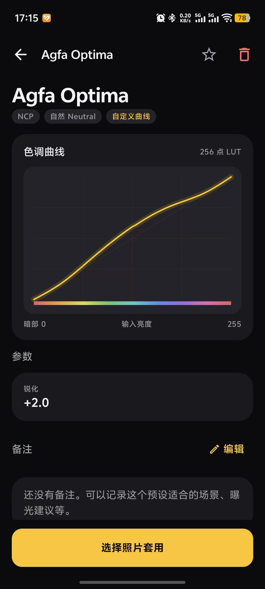
  </div>


---

**4 · 相册选照片，选预设套用**
- 从系统相册选择多张照片（含相册下拉 + 批量勾选），选择完成后底部弹窗展示选定照片的预设缩略图预览  
  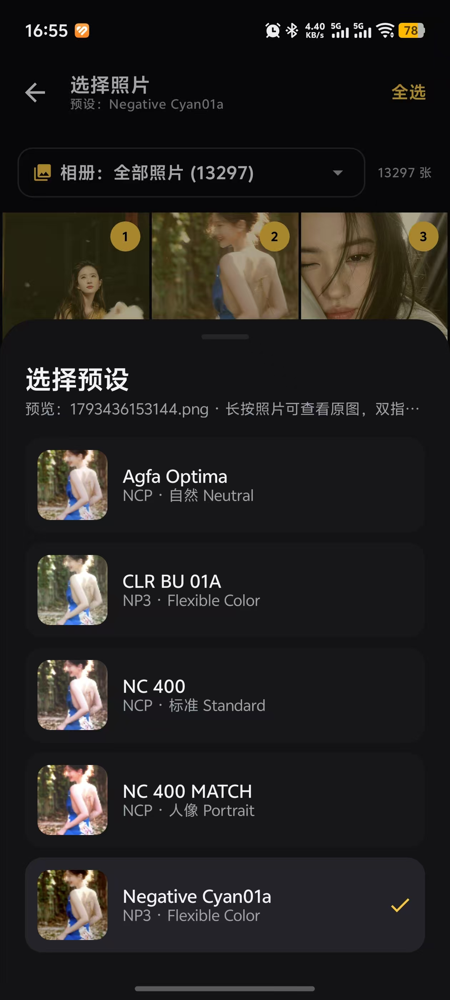


---

**5 · 套用预设**
- 预设套用后的实时预览界面，可切换预设  
  <div style="display: flex; justify-content: center; gap: 10px;">
    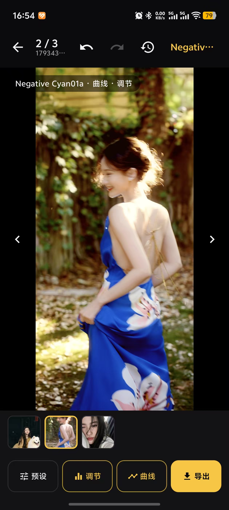
    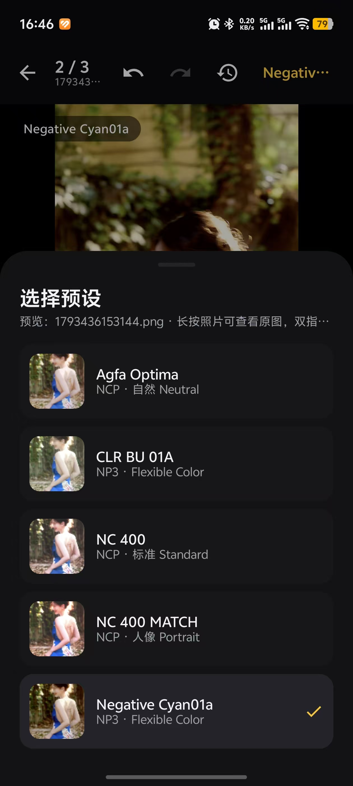
  </div>

---

**6 · 手动调整参数**
- 手动调节色彩参数面板，光线/颜色/细节分组，双击归零，可保存为新预设  
  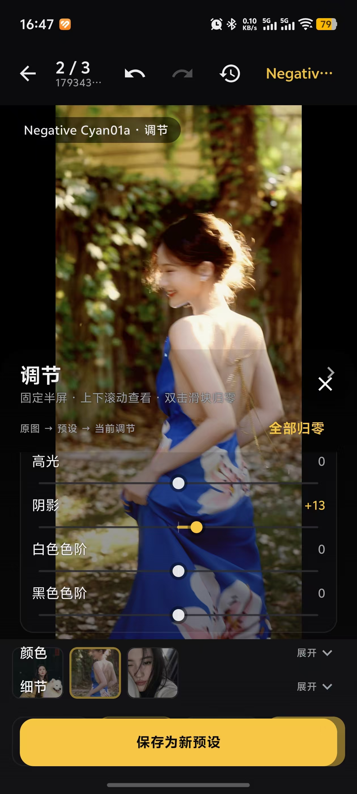


---

**7 · RGB 曲线编辑**
- 半透明曲线编辑器，拖动控制点实时刷新预览  
  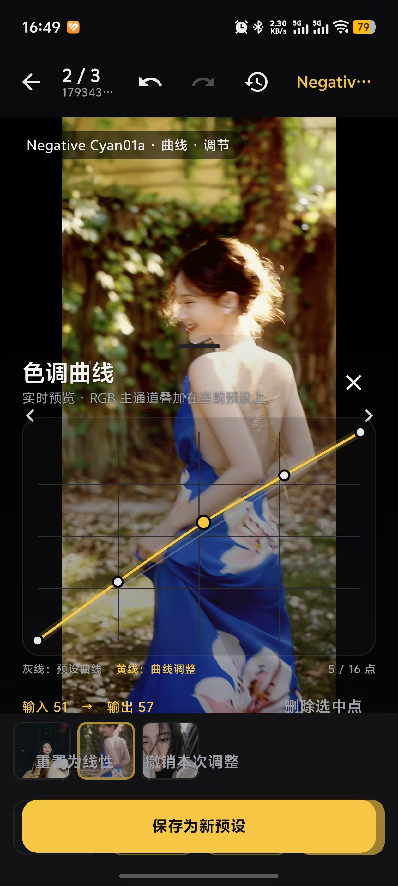


---

**8 · 导出**
- 1.6.29 起从右上角「更多」→「导出」进入；批量导出 JPG/PNG 格式，保留 EXIF，每张照片使用自己最终的效果  
  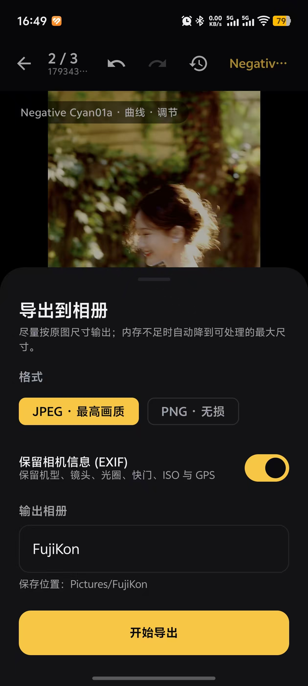


---

**9 · RGB直方图，修图提示，一键优化**
- 显示RGB直方图，并根据当前RGB直方图分布情况，动态显示修图提示，以及「一键优化」按钮（本机自动校正影调）  
  
  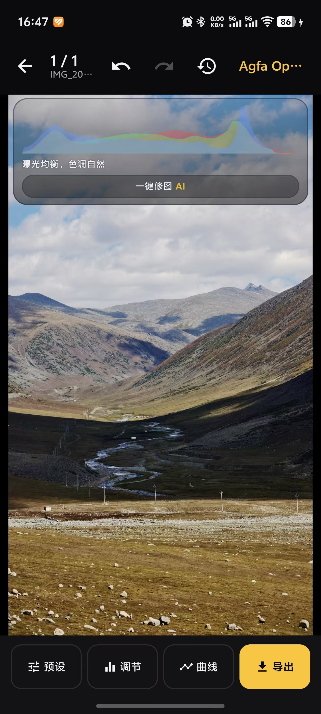

## 构建

环境：

- JDK 17
- Android SDK Platform 35、Build-Tools 35.0.0
- Gradle 8.9（项目含 wrapper）

```bat
gradlew.bat :app:assembleDebug
```

> wrapper 默认使用腾讯云 Gradle 镜像以加快国内下载；如需官方源，可把 `gradle/wrapper/gradle-wrapper.properties` 中的 `distributionUrl` 改回 `https://services.gradle.org/distributions/gradle-8.9-bin.zip`。

如果本机没有配置 `ANDROID_HOME`，在项目根目录创建 `local.properties`：

```properties
sdk.dir=D:/Android/Sdk
```

产物按应用版本号命名，不使用 `debug` 后缀：

```
app/build/outputs/apk/debug/FujiKon-1.6.5.apk
app/build/outputs/apk/release/FujiKon-1.6.5.apk
```

安装：

```bat
adb install -r app/build/outputs/apk/debug/FujiKon-1.6.5.apk
```

版本规范（自 1.6.4 起）：

- `versionName` 使用语义化版本 `MAJOR.MINOR.PATCH`。
- **每次小迭代只在 PATCH 位 `+0.0.1`**（`1.6.5` → `1.6.6` → `1.6.7` …），不跳跃 MINOR / MAJOR，避免版本号断层；仅当确属重大功能或架构变更时，由维护者显式决定提升 MINOR / MAJOR。
- `versionCode` 每轮 +1 且**严格单调递增**，保证 Android 可覆盖安装；若变基后远端 `versionCode` 落后于本地已发布值，则取已发布最大值 +1（当时远端 1.6.3 的 10 → 1.6.4 的 13，因为 11/12 已被旧包占用；后续每轮 +1，1.6.5 为 14），不得回退。`versionName` 可以随远端基线调整。
- 变基到远端最新提交后，版本基线以远端 `versionName` 为准，再按 `+0.0.1` 递增（例如当时远端 `1.6.3` → `1.6.4`）。
- APK 统一命名为 `FujiKon-<versionName>.apk`，例如 `FujiKon-1.6.5.apk`。
- 每次提交新版本代码时创建对应的 annotated Git tag，例如 `v1.6.5`。

## 使用

1. 首次启动会自动载入 4 个内置示例预设。
2. 首页点“导入预设”，选择一个或多个 `.NCP` / `.NP3` 文件；也可以点“从 nikonpc 下载”浏览在线预设，单个导入或全部导入，或点“尼康云创官方滤镜”浏览官方色彩方案。
3. 点“选照片套用”，在预设列表中选择预设；选择“无（保留原图）”则不套用任何 Picture Control，直接进入后续编辑。
4. 勾选照片，可切换相册、全选当前相册；点“下一步”。
5. 预览页：
   - 长按图片对比原图；
   - 双指缩放、拖动查看细节；
   - 双击快速放大/还原；
   - 底部缩略图切换照片；
   - “预设”即时切换并重新渲染，也可以随时切回“无（保留原图）”；
   - “调节”打开近乎透明的调节面板，可实时调整光线、颜色、细节、**画质**（降噪 / 颗粒 / 暗角）、**点颜色**、**局部**、人像、HSL 和滤镜；HSL 支持 8 个色带，双击某个滑块把它归零，“全部归零”把所有调节参数、画质算子、点颜色、局部图层、人像美颜、HSL、裁剪、镜头模糊和滤镜清零；
   - “局部”分组内可添加最多 12 层蒙版：切换控制点 / 线性 / 径向 / 画笔，在画布上点按或拖动定位选区、涂抹画笔，用滑杆调半径与羽化，再单独调该选区的亮度 / 对比度 / 高光 / 阴影 / 饱和度 / 色温 / 清晰度；可反转选区、停用图层、删除图层。一键优化生成的自动层以 `auto:` 开头，会被下次优化替换，你手绘的图层始终保留；
   - “画质”分组的降噪在锐化之前执行，颗粒用坐标哈希生成（同一张图预览与导出一致、重复渲染字节相同），暗角负值压暗四角；
   - “影调”分组内可编辑影调曲线；单独的“曲线”按钮打开半透明曲线编辑器，顶部可切换 RGB 主通道与红 / 绿 / 蓝分通道（每个通道的控制点独立保存），点击空白添加控制点、拖动调整、双击删除；拖动时照片会以节流方式实时刷新，曲线叠加在当前预设之上，并用于当前预览和批量导出；
   - “裁剪”打开全屏裁剪 / 纠偏界面：在裁剪框内拖动移动画面，双指缩放调整裁剪范围，拖动四角改大小，可左右旋转 90°，用“纠偏”滑块旋转照片，选择比例（自由、原图、1:1、4:3、3:4、3:2、2:3、16:9、9:16），点“完成”应用，“重置”恢复全图；预览与导出使用同一裁切区域。
   - “模糊”打开全屏镜头模糊编辑器：点按照片设置焦点（拖动可移动），调节模糊强度、聚焦范围、边缘过渡与散景高光，点“自动对焦”让应用按画面细节挑选焦点，点“完成”应用；拖动滑块时实时刷新预览，导出使用同一套参数。
   - “调节”面板中的“人像”分组提供磨皮、美白、红润、立体四个滑杆与五种一键风格（自然 / 清透 / 奶油肌 / 日系 / 质感）；只对识别到的肤色生效，可逐一微调，改动后自动标记为“自定义”；
   - 点底部“AI”按钮打开一键 AI 修图：输入自定义提示词（可点“快捷灵感”填充，或点「生成提示词」由 Agnes 3.0 Flash 分析画面自动填词），确认后把当前预览图发送给 Agnes 图像大模型；生成期间可取消，完成后结果作为最终照片显示，导出时直接使用；底部会出现“已应用 AI 修图结果”标记条，点“撤销”返回本地渲染。未配置密钥时会弹窗并给出“去设置”按钮。
   - 在“调节”或“曲线”面板中点“保存为新预设”，当前调节、HSL、人像美颜、裁剪、镜头模糊、滤镜、曲线与预设参数会作为新副本加入预设列表。
   - 系统返回（含全面屏边缘侧滑返回）在预设、调节、裁剪、模糊、曲线、蒙版、历史、导出等子页面上**只关闭当前页面并回到预览效果图**，多层叠加时逐层退出；所有子页面都关闭后再次返回才回到上一页（选择照片）。取色层优先退出、保存进行中不会误退、导出进行中按返回会取消导出。
6. 点“导出”，选择 JPEG/PNG、是否保留 EXIF、输出相册名，开始批量导出。

## 在线预设（nikonpc.com）

首页的“从 nikonpc 下载”会读取 [nikonpc.com](https://nikonpc.com/) 的公开预设列表，目前约 166 个。单个导入会下载并生成本地 `.NCP`，全部导入使用 4 路并发并显示进度，可随时取消。

- 列表每行显示该预设套用在 nikonpc.com 自身预览照片（网站 `cLutImage` 画布所用的 `inpImageUrl` 样张）上的效果图，以及由基础 Picture Control、曲线和各项参数生成的简要说明；只在行进入可见区域时下载并生成，结果会复用缓存，导入时无需再次下载。
- nikonpc.com 不提供每个预设的静态示例图或创作者说明，网站预览是浏览器端把预设 LUT 实时绘制在同一张照片上；应用下载这张照片后在本地套用预设，效果与网站预览一致。说明由参数推导，若预设文件内嵌说明文字则优先使用。
- 搜索支持名称、分类、槽位和说明内容；输入关键词后会按需请求 `loadNpc` 元数据补全尚未加载的说明。
- 导入前会用文件内容哈希去重；已经存在的相同预设不会重复添加。
- 下载的 NCP 会缓存到应用缓存目录，重复导入时不再请求下载接口。
- 在线预设功能需要 `INTERNET` 权限；这部分不会上传照片、相册或本地预设（AI 修图除外，见下文）。
- 预设名称和版权归 nikonpc.com 及其作者所有。

## 尼康云创（Nikon Imaging Cloud）

首页的“尼康云创官方滤镜”读取 Nikon Imaging Cloud 的公开色彩方案库（约 140+ 个，含 Nikon 原创与创作者方案），无需登录尼康账号：

- 列表显示缩略图、方案名、创作者与 Picture Control 名称；每行进入可见区域时才请求该方案的详情，并用创作者说明的首句作为列表摘要，避免一次性请求全部方案。
- “导入”会按云创公开的参数生成应用内预设：基准 Picture Control、锐化、中域锐化、清晰度、饱和度，以及公开为数值的对比度/高光/阴影/白色/黑色；按方案 ID 去重（`nic:<id>`），已导入的方案显示“已存在”。
- 云创接口把部分参数返回为 `gamma`（自定义色调曲线未公开），应用无法还原这部分曲线，因此导入效果可能与机内直出略有差异；界面底部与预设说明中均有提示。
- 接口地址与字段来自 imagingcloud.nikon.com 网页端使用的公开 BFF（`api.user.cwp.imagingcloud.nikon.com`），若官方调整接口，列表会显示加载失败并允许重试。
- 色彩方案版权归 Nikon 及创作者所有；应用不上传照片或本地预设。

## NCP / NP3 支持

容器是 big-endian TLV：

```
"NCP\0" [id:u32][size:u32][body...] ... [0x00000000]
```

| 格式            | 识别方式                          | 主要记录                                                                                                                                                         |
| ------------- | ----------------------------- | ------------------------------------------------------------------------------------------------------------------------------------------------------------ |
| NCP 0100      | 文件头 `NCP\0`，版本 `01xx`         | `1` 设置、`2` 578 字节曲线体                                                                                                                                         |
| NP2 0200      | 文件头 `NP2\0` 或版本 `02xx`        | 尽力按 NCP 记录 `1` 解析                                                                                                                                            |
| NP3 0300/0310 | 文件头 `NCP\0`/`NP3\0`，版本 `03xx` | `0x0100` 版本、`0x0200` 名称、`0x0300` 基准、`0x0600` 锐化、`0x0700` 清晰度、`0x1600` 中间锐度、`0x1900`~`0x1E00` 影调/色彩、`0x1F00` Color Blender、`0x2000` Color Grading、可选记录 `2` 曲线 |

曲线体：`body[8]` 为控制点数量，`body[66]` 起为 256 个 big-endian `u16` LUT（0..32767）。完全水平的 LUT 视为“无曲线”。

基准 Picture Control ID：`0x0020` 灵活色彩、`0x0001` 标准、`0x00C3` 鲜艳、`0x03C2` 自然、`0x0486` 人像、`0x04C7` 风景、`0x064D` 单色。

解析器有 JVM 单元测试，使用真实 NCP/NP3 文件覆盖 NCP 曲线、NP3 Color Blender/Grading、NP3 曲线记录与损坏文件拒绝：

```bat
gradlew.bat :app:testDebugUnitTest
```

测试还包含色调曲线插值/归一化/边界测试、调节参数 JSON 与预设持久化、HSL/裁剪/滤镜/人像美颜 JSON 与边界测试、曲线 JSON 持久化与预设副本删除保护、渲染器曲线叠加与调节效果测试、无预设恒等渲染、裁剪尺寸、滤镜混合与 HSL 渲染测试、人像磨皮只作用于肤色且美白/红润生效、Compose 曲线编辑器加点/拖动/双击手势测试、调节滑块拖动/双击归零测试、裁剪比例/移动/缩放/纠偏几何测试、自由裁剪 JSON 与像素尺寸测试、Compose 裁剪编辑器应用/取消测试、预设面板“无”选项测试，以及 Robolectric 启动/仓库/图像 I/O/渲染冒烟测试、Compose 首页/预设面板 UI 测试和长按对比手势测试；nikonpc 在线导入还覆盖目录解析、详情/form 映射、本地 HTTP 下载与缓存、异常 NCP 修复；尼康云创覆盖列表/详情 JSON 解析、说明摘要提取、参数映射与预设生成。Robolectric 首次运行会下载 Android 运行时（默认走阿里云镜像）；可覆盖：

```bat
gradlew.bat :app:testDebugUnitTest -ProbolectricRepo=https://repo1.maven.org/maven2
gradlew.bat :app:testDebugUnitTest -ProbolectricDir=C:/path/to/android-all-instrumented.jar
```

静态检查：

```bat
gradlew.bat :app:lintDebug
```

## 渲染管线

CPU 渲染，按行分块并行：

1. 人像美颜（磨皮/美白/红润/立体，仅作用于肤色掩码内；先于调色执行，避免黑白或强滤镜破坏肤色识别）
2. 文件 256 点 LUT（若有）；“无预设”使用恒等 LUT
3. 基准色彩（标准/鲜艳/自然/人像/风景/单色）的对比度与饱和度倾向
4. 对比度、亮度、高光、阴影、白色、黑色
5. 用户 RGB 主通道色调曲线，随后叠加红 / 绿 / 蓝分通道曲线（都在预设之上；单调三次插值，端点固定；四条曲线各自独立，线性通道为恒等）
6. 饱和度、色相矩阵
7. Color Blender（按色相带加权）
8. Color Grading（高光/中间调/阴影加权，含混合与平衡）
9. 单色滤镜与色调
10. 用户调节：色温/色调、曝光、对比度、高光/阴影/白色/黑色、自然饱和度、去朦胧
11. 用户 8 色带 HSL
12. 内置风光/人像创意滤镜（按强度与当前结果混合）
13. **独立降噪**（1.6.9 新增）：边缘保持的双边滤波，按颜色距离加权邻域，跨边缘的像素权重自动降低；刻意排在锐化之前，避免放大噪点
14. 用户纹理/清晰度 + 细锐化（近似 unsharp mask）
15. **点颜色**（1.6.9 新增）：按 HSL 色相距离与最低饱和度阈值选取一档颜色，只对它做色相 / 饱和度 / 明度偏移
16. **局部调整层**（1.6.9 新增）：把控制点 / 线性 / 径向 / 画笔四种选区栅格化到最长边 ≤384 的浮点网格，逐像素双线性采样后按权重混合该层的局部参数；RGB 全程浮点，最后只量化一次
17. **颗粒 / 暗角**（1.6.9 新增）：确定性坐标哈希颗粒（中间调权重高、高光干净），以及可调正负暗角
18. 镜头模糊（焦点区域内保持清晰，区域外按距离渐进做三次盒式模糊以近似高斯；大图在降采样副本上模糊再上采样，散景高光会先提亮高光点）
19. 非破坏性裁剪 / 纠偏（比例、90° 旋转、±45° 纠偏与自由裁剪框；旋转时自动放大避免空白角，再双线性重采样到裁剪区域，预览与导出共用同一套归一化参数）

> **关于「GPU / 高位深渲染」**：1.6.9 交付的是 16bit 等效精度的高位深中间计算 + 可插拔 `RenderBackend` 接口（当前只有 `CpuRenderBackend`），并未把管线重写为 OpenGL ES / Vulkan。原因是沙箱无 AVD / KVM，无法对 GPU 后端做像素级验证；先固化精度与接口，后续接入 GPU 后端时不需要改动算子契约。

这是对尼康色彩科学的**近似实现**，不是尼康官方算法。渲染结果可能与相机直出或尼康软件存在差异。

### 分通道曲线与预设兼容

`Preset.toneCurve` 仍是 RGB 主通道曲线，红 / 绿 / 蓝三条曲线保存在 `Preset.channelCurves`（预设 JSON 的 `channelCurves` 字段）。只有启用了分通道曲线时才写入该字段：旧版本 App 读取新预设会忽略它并继续套用主通道曲线，不会报错；新版本读取旧预设时得到全线性通道，渲染结果与升级前完全一致。

渲染时先生成含尼康 LUT、预设影调和主通道曲线的 256 点主 LUT，再把各分通道曲线叠加成红 / 绿 / 蓝三张 LUT，逐像素各查一次表。分通道曲线作用于**主 LUT 的输出值**，因此线性通道与未启用分通道时完全等价，不引入逐像素的额外计算。切换预设、撤销 / 重做、保存为新预设与批量导出都会带上分通道曲线，缩略图缓存键也包含分通道参数。

## 一键优化（本机自动画质优化）

直方图卡片下方的「**一键优化**」是一个完全在本机 CPU 运行的自动调色引擎：**不调用任何在线模型、不上传照片、不需要密钥、无需等待**，结果就是一组普通的可撤销调节参数。它按「日常户外抓拍」的大众审美（通透光感 + 青蓝绿背景配柔黄主体 + 保留细节 + 微柔光）设计，但有三条铁律：**曲线优先**、**跟着原片走**、**闭环收敛**。

从 1.6.11 起它是「**真正一键**」：点一下，App 用真实 `ImageRenderer` 把候选参数作用到**原图**的降采样副本上，逐像素测回溢出与明暗分布，若不达标就只修正光感参数（曝光 / 对比度 / 高光 / 阴影 / 白 / 黑）再渲染验证，如此循环直到达标（最多 6 轮；未达标则返回实测最优的一轮，绝不盲给参数）。**配色 / 质感 / 分区层完全不参与迭代**，四步配方不会被收敛过程改写。

> **1.6.12 修正「压高光过头」**：1.6.11 把「不过曝」错当成「消灭所有近白像素」（高光剪切 ≤ 2%），闭环会持续把 `highlights` 压到 −80、`whites` 到 −60 并降低整体曝光，亮部被压成灰，色彩、光感和层次一起丢失。现在**「不过曝」的正确定义是「不出现无色死白」**：`analyse()` 新增 `blownWhiteClip`（亮度 > 0.965 **且** 色度 < 0.09 的无细节溢出像素占比），明亮但**有色**的亮部（暖阳、淡蓝天空、白裙）一律不算过曝、必须保留。达标标准改为「无色死白 ≤ 3.5% / 暗部死黑 ≤ 3%」+ **相对原片的亮部亮度 / 色彩 / 层次 / 整体亮度保留线**（对死白撑高的 p95 与原片自然的低饱和做了去污染处理）；`refine()` 优先用窄域白场控制而非宽域高光滑块，且**不再压暗整体曝光**。界面显示「闭环 N 轮达标 · 死白 x% / 暗部 y%」。

1. **先测量**：把当前预览缩到 384 px，逐像素测出 256 级亮度直方图、均值 / 标准差 / 百分位、暗部与高光剪切比、饱和度、邻域梯度（细节），以及绿色背景 / 暖黄主体 / 肤色 / 暗部暖度等颜色证据。
2. **曲线打底（主）**：由直方图实际缺陷生成一条主 RGB 色调曲线——暗部抬脚救死黑、亮部回落救死白、真 S 形拉出色彩层次。缺陷≈0 时曲线接近恒等，**好照片几乎不动**；曝光 / 对比度只是曲线之后的微小补充，且被「原片影调越好越不动」的总闸收敛，不会再出现「过分调曝光对比度毁图」。
3. **跟着原片走（连续自适应）**：**只有实测出现无色死白才压高光**，且以主曲线的亮部柔和回落为主、滑块只做小幅辅助（硬上限 `highlights ≥ −16`、闭环修正 `≥ −28`）；明亮有色的亮部一律保留。提阴影、纹理+ / 清晰度−（轻微柔焦）、曝光二次微调同样是**缺陷量的连续函数**并有硬上限，没有固定档位；原片暗就多提阴影、原片艳就降饱和。
4. **配色按原片触发（不硬套）**：仅当实测确有绿色背景 → 绿 / 青段往清透青蓝绿推并略降饱和；确有暖黄主体 → 黄 / 橙段柔和不刺眼；确有户外绿背景且暗部发闷 → 只对暗部加极淡蓝调（`shadowTint`，通道偏移硬上限约 5%）。室内暖光人像、雪景、夜景、蓝天等**检测不到对应颜色就完全不染色**，氛围色（暖阳 / 冷白 / 夜蓝）一律保留，色温只做温和的冷偏校正、不中和暖调。
5. **分区自适应（1.6.9 新增）**：全局曲线仍是主力，此外按**分区证据**追加少量局部调整层——实测有天空**死白** → 上部渐变温和收敛死白（1.6.12 起**不再降天空饱和**，避免丢色彩）；实测暗部死黑 → 主体控制点提阴影；实测绿色背景且整体过饱和 → 反选径向收敛背景饱和度。每层都有覆盖率与缺陷量双门控、硬上限，无证据就不生成；好照片走短路，**一个局部层都不加**。自动层 id 以 `auto:` 开头，每次优化替换上次自动层但保留你手绘的图层，因此连点仍然精确幂等。
6. **幂等 / 非破坏**：输出的是基于原图求出的**绝对参数**（不是往当前值上累加），连点两次结果一致；保留用户已有的裁剪 / 虚化 / 人像 / 滤镜、画质算子、点颜色与手绘局部图层。结果就是普通 `EditAdjustments`，预览与批量导出共用同一套参数，可撤销、可继续用滑块微调。
7. **闭环达标（1.6.11 新增，1.6.12 修正标准）**：在以上配方之上，对原图降采样副本做「渲染 → `analyse()` 实测 → 按偏差修正 → 再验证」的迭代，直到**无色死白 ≤ 3.5% / 暗部死黑 ≤ 3%**，且真实渲染仍保有原片的亮部亮度、色彩与层次（相对保留线 + 去污染上限，见上文）；每轮步长递减保证收敛，最多 6 轮，取实测缺陷最小的一轮。缺陷函数额外惩罚「压过头」——把亮部压灰、洗掉色彩或压平层次都会得高分，因此闭环**天然避开** 1.6.11 那种灰暗结果。修正只动光感参数且**不再降低整体曝光**，青蓝绿配柔黄、纹理 / 清晰度、局部层一律不动。好照片且原片已达标时**零渲染直接返回精确 `Neutral`**；始终以原图为基准重算绝对参数，因此连点仍然精确幂等。

**关于「一键优化分区」的如实说明（勿与蒙版 AI 选区混淆）**：这里存在两套**用途与实现完全不同**的分割能力。① **一键优化的分区自适应**仍使用 `HeuristicSegmentationProvider`——基于像素颜色、亮度与构图位置的**启发式**软分区（天空 / 植被 / 肤色 / 主体），输出 96×96 掩码与各区质心、覆盖率；它**不是 AI 语义分割模型**，不需要模型文件、不联网、无算力开销，界面上明确标注「本机色彩/位置启发式分区（非 AI 模型）」，绝不伪装成 AI。`SegmentationProvider` 是公开接口，后续可注入 TFLite / ONNX Runtime 模型实现，无需改动 `AutoEnhance.suggestZoned()` 或渲染器；主体分区目前是「中心显著性先验」，不是物体检测，无法提供分割结果时（如无预览位图）自动降级为纯全局求解。② **蒙版的三类内容感知选区**（选择主体 / 选择天空 / 选择颜色范围）自 **1.6.23** 起已是真正的**端侧 AI 语义分割**（见上文「内容感知选区」），由 `MlSegmentation` + `SelectionAiProvider` 驱动，两个 TFLite 模型在 `assets/`；两者互不影响。

对已经曝光均衡、白平衡中性、无剪切的照片会判定「无需处理」并原样保留（结果精确等于 `Neutral`）。验收以**真实渲染后像素**的客观指标衡量（见 `AutoEnhanceTest` / `ClosedLoopOptimizerTest` / `SampleAcceptanceTest`）：合成问题图一键优化后亮度向中灰靠拢、反差与细节提升、冷偏收敛、不产生死白溢出、综合画质分提高；闭环样张实测**无色死白** `0.425 → 0`、暗部剪切 `0.550 → 0`，死黑图缺陷轨迹 `0.258 → 0.149 → 0.074 → 0.028 → 0` 逐轮收敛到标准。1.6.12 新增「不压过头」验收：过曝样张真实渲染后 **p95 保留 89%、饱和保留 92%、整体亮度保留 92%**；明亮有色户外样张收敛 10% 死白后 **p95 仍 0.875、饱和保留 90%、亮度保留 93%**，且 `highlights / whites` 均不越过温和上限、天空自动层不再降饱和。另有回归用例守护「好照片精确不动」「连点幂等」「夜景 / 蓝天不被染色」「闭环不改写四步配方」「报告与真实渲染一致」。

> 说明：以上为合成 / 虚拟设备像素级验证，真机观感仍以实拍照片为准。1.6.9 起渲染管线已有**独立降噪算子**（「画质」分组的降噪滑杆，双边滤波，作用在锐化之前），但一键优化本身**默认不启用降噪**——自动调色仍靠 `texture+ / clarity−` 的「保留高频细节 + 中频柔化」组合做轻微柔焦，避免在不确定是否有噪点时把细节糊掉；需要降噪时手动拉滑杆即可。

## 生成提示词（Agnes 3.0 Flash 文本模型）

编辑页点「AI」→「快捷灵感」栏目下方的「**生成提示词**」按钮，会把当前预览图交给 Agnes 3.0 Flash 文本大模型做画面分析，返回一句针对这张照片的中文优化提示词并**自动填入自定义提示词输入框**；你可以继续修改、删改、补充后再点「开始修图」，也可以只借这段词做参考。

严格按 [Agnes 3.0 Flash 官方文档](https://www.agnes-ai.cn/zh-Hans/docs/agnes-30-flash) 接入：

| 项 | 实现 |
|---|---|
| Endpoint | `POST https://api.agnes-ai.cn/v1/chat/completions`（国际区 `apihub.agnes-ai.com`）|
| 认证 | `Authorization: Bearer <API_KEY>`、`Content-Type: application/json` |
| 模型名 | `agnes-3.0-flash` |
| 图像输入 | `messages[1].content` 为内容块数组，含 `{"type":"image_url","image_url":{"url":…}}` |
| 输出解析 | `choices[0].message.content`（兼容内容块数组），去引号 / Markdown / 标签并限长 500 |
| 采样参数 | `temperature 0.4`、`max_tokens 300`、`stream:false` |

```json
{
  "model": "agnes-3.0-flash",
  "messages": [
    {"role": "system", "content": "你是资深摄影后期师……只输出提示词本身"},
    {"role": "user", "content": [
      {"type": "text", "text": "分析这张照片的曝光、色偏、反差、色彩与细节问题……"},
      {"type": "image_url", "image_url": {"url": "data:image/jpeg;base64,…"}}
    ]}
  ],
  "temperature": 0.4,
  "max_tokens": 300,
  "stream": false
}
```

**关于图像 URL 与降级（如实说明）**

- 官方文档把图像输入描述为**公开可访问的 `image_url`**。App 没有自带公网图床，默认把当前预览图（最长边 768 px、JPEG q82）编码成 base64 Data URI 放进 `image_url.url`（OpenAI 兼容视觉接口的通用格式）。若账户 / 网关明确拒绝 Data URI，可在设置中填写自己上传得到的公网图片 URL（`AppSettings.agnesImagePublicUrl`，选填），客户端会改用它。
- [Agnes 3.0 Flash 官方文档](https://www.agnes-ai.cn/zh-Hans/docs/agnes-30-flash) 列出的模型是**已上线**的（有刊例价与体验价，无「即将上线」标注）。若接口返回 404 / 模型相关的 400 / 5xx / 网络异常，App 仍会**自动降级为本机图像分析**（复用「一键优化」的同一套像素统计）生成针对该照片的中文提示词，并在界面上如实标注来源，既不伪装成大模型结果，也不让按钮失效。401/403（密钥 / 权限）与 429（限流）不降级，直接给出可读错误。
- 未配置密钥时同样可用本机降级生成提示词，界面明确提示「尚未配置密钥」；真正点「开始修图」时才提示去设置录入密钥。

## 一键 AI 修图（Agnes）

FujiKon 接入 Agnes 最新一代图像大模型 `agnes-image-2.5-flash`（图生图 / 图像编辑），严格按[官方接入文档](https://www.agnes-ai.cn/zh-Hans/docs/agnes-image-25-flash)实现。与本机 CPU 渲染不同，这是**唯一会联网上传照片**的功能。

### 配置密钥

1. 打开「设置 → AI 修图」（设置页第一项），在「API 密钥」输入框粘贴你的 Agnes API 密钥，点「保存密钥」。密钥以 `SharedPreferences` 保存在**本机**，只作为 `Authorization: Bearer` 头附加到你主动发起的请求，不会同步到别处。
2. **保存后输入框不清空**，卡片会常驻显示「已配置」状态、密钥指纹（首尾各 4 位 + 总位数）；重新进入设置页也会回显已存密钥，点右侧眼睛可随时查看完整明文核对是否正确。
3. **接入区域**：密钥不跨区域通用。默认「中国区 `api.agnes-ai.cn`」（官方端点）；若密钥申请自国际网关，切换到「国际区 `apihub.agnes-ai.com`」。选错时服务会返回「无效的令牌」。
4. 点「**验证密钥**」会用一句最小提示词发起一次真实请求（不上传照片，当前体验价免费），结果常驻显示：密钥有效 / 无效（附服务端原文如「无效的令牌」）/ 额度受限 / 服务或网络异常。**当前区域返回 401/403 时会自动再试另一区域**，成功则自动记住可用区域，无需手工判断密钥属于哪个站点；两次都失败才会报告密钥无效。
5. 未配置密钥时仍可打开提示词编辑器（「生成提示词」会走本机降级）；点「开始修图」或修图失败时才弹窗给出「去设置」按钮；已配置的密钥可随时「清除」。
6. 401/403 会显示服务端原始原因和**当前端点域名**，429 提示额度/限流，5xx 提示服务暂不可用，网络异常也会给出可读提示。

### 使用流程

编辑页底部点「AI」→ 在弹窗中输入自定义提示词（最多 500 字；可选「快捷灵感」、或点「生成提示词」让文本模型分析画面自动填词后自行修改）→「开始修图」。App 把**当前预览图**（已含预设、调节、曲线、裁剪等全部本地效果）压缩为 JPEG，以 Data URI 放进 `extra_body.image`，连同提示词一起 POST 到官方文档指定的 `https://api.agnes-ai.cn/v1/images/generations`（国际区密钥走 `https://apihub.agnes-ai.com/v1/images/generations`），并要求 `extra_body.response_format = "b64_json"`。生成通常需要十几秒到数十秒，期间可取消。

返回的图片字节经合法性校验后**原样写入应用缓存**（不二次压缩），作为该照片的「最终成品图」：预览直接显示它，长按仍可对比原图，导出时跳过本机渲染直接保存它（因此不会把预设叠加第二次）。底部出现「已应用 AI 修图结果」标记条，点「撤销」即隐藏 AI 层并返回本地渲染链路。1.6.9 起 AI 结果作为 `EditSnapshot.aiResultUri` **纳入编辑历史栈**：应用 / 隐藏各记一步，撤销 / 重做 / 跳转历史会把 AI 层与当时的本地调色参数一起恢复（缓存文件因此不再在隐藏时立即删除，随应用缓存统一清理）。多张照片各自的 AI 结果独立保存；修改本地参数前仍需先隐藏 AI 结果（AI 图层仍是整图替换，不是可蒙版的混合层）。1.6.27 起**撤销 / 重做 / 跳转历史不再切换当前照片**（旧实现会跳回第一张）；1.6.28 起历史栈进一步改为**每张照片独立**——「下一步」批量套用预设之后，每张照片各自保存调色参数与操作历史，回退 / 重做只作用于当前预览的照片，不会影响其他照片。

请求体关键字段（遵循官方文档：`response_format` 不能放顶层，也不发送 `tags`）：

```json
{
  "model": "agnes-image-2.5-flash",
  "prompt": "把天空改成星空，保留原构图",
  "size": "1K",
  "ratio": "3:4",
  "extra_body": {
    "image": ["data:image/jpeg;base64,..."],
    "response_format": "b64_json"
  }
}
```

`ratio` 按当前预览图宽高比映射到模型支持的最接近档位（1:1 / 3:4 / 4:3 / 16:9 / 9:16 / 2:3 / 3:2 / 21:9）。响应优先取 `data[0].b64_json`，也兼容返回临时 `data[0].url` 时下载图片。

### 接入检查清单（对照官方文档）

| 项 | 实现 |
|---|---|
| Endpoint | `POST https://api.agnes-ai.cn/v1/images/generations`（可选国际区 `apihub.agnes-ai.com`）|
| 认证 | `Authorization: Bearer <API_KEY>` |
| 模型名 | `agnes-image-2.5-flash` |
| 必填参数 | `model`、`prompt`、`size`（`1K`），配 `ratio` |
| 图生图 | `extra_body.image` 传 Data URI 数组 `["data:image/jpeg;base64,…"]` |
| Base64 输出 | `extra_body.response_format: "b64_json"` |
| 禁止 | 顶层 `response_format`、`tags: ["img2img"]` |
| 超时 | 读超时 180s（文档建议 60–360s）|

> 早期版本曾误用 `apihub.agnes-ai.com` + `agnes-image-2.1-flash`（来自旧版英文 wiki），导致中国区密钥始终返回 401「Invalid token」；现已改用官方文档端点与模型，并保留区域切换兼容国际网关密钥。
>
> 1.6.4 把直方图卡片原来的「一键修图 AI」按钮更名为「一键优化」，并用闭环求解引擎替换旧的弱规则式微调（见下节）；同时新增「生成提示词」（最初按 Agnes 3.0 Pro 文档接入）。
>
> 1.6.5 因 Agnes 3.0 Pro 官方仍标注「即将上线」、无法调用，把「生成提示词」切换到已上线的 [Agnes 3.0 Flash 官方文档](https://www.agnes-ai.cn/zh-Hans/docs/agnes-30-flash)（`agnes-3.0-flash`）；端点、认证与 `image_url` 内容块不变，并让降级提示按原因区分，不再显示成「模型暂不可用」。
>
> 1.6.6 把一键优化改为**曲线主导**（先曲线优化光感 / 层次 / 死黑死白，再小幅补其它参数），修复「过分调曝光对比度毁图」。
>
> 1.6.7 按「日常户外抓拍」配方重构曲线之后的调色逻辑：全部参数改为**跟着原片走的连续自适应**、配色**按原片颜色证据触发**、新增仅作用于暗部的 `shadowTint` 冷蓝分离色调；白平衡不再中和暖阳 / 冷白 / 夜蓝等氛围色，并改为**幂等的绝对参数**、新增好照片 / 幂等 / 不染色回归用例。详见「一键优化」章节。
>
> 1.6.8 移除退役的预置示例「NC 400 MATCH」（`assets/samples/nc400_match.ncp`）：新装不再载入，升级时按**名称 + 内容哈希**自动清理旧索引里由应用内置的对应条目（含被重命名过的；用户自行导入的同名或同内容预设不受影响）；内置示例由 5 个减为 4 个，UI 说明与测试用例同步更新。
>
> 1.6.9 一次性补齐四项对标能力：① **局部调整**（控制点 / 线性 / 径向 / 画笔四种蒙版，最多 12 层，随预设与历史保存）；② **画质算子**（独立保边降噪、确定性颗粒、暗角、点颜色）；③ **分区自适应一键优化**（可插拔 `SegmentationProvider`，本版为离线启发式分区，界面如实标注非 AI 模型，证据门控 + 幂等 + 好照片短路）；④ **自适应预设推荐**（复用 `ImageStats` 的离线可解释排序）。另交付 16bit 等效浮点中间计算与可插拔 `RenderBackend` 接口，并把 **AI 修图结果纳入 `EditSnapshot` 历史栈**（撤销 / 重做 / 跳转会一起恢复 AI 层与本地调色）。新增 21 个测试，全量 244 个通过。GPU 后端与模型化语义分割未随本版发布，原因见「渲染管线」与「一键优化」章节。（注：**模型化语义分割已于 1.6.23 在蒙版的三类内容感知选区落地**，见上文「内容感知选区」；GPU 后端至今仍未实现。）
>
> 1.6.10 直方图卡片里的「分区说明」与「本机推荐预设」合并为一个**可折叠面板**：两块文字统一改为**白色**并加柔和阴影，保证叠在明亮照片上也清晰；面板上方新增常驻的**下拉 / 收起箭头**，点一下即可显示或隐藏这两块内容（当时默认展开，无分区 / 无推荐时图标自动隐藏；**1.6.25 起改为默认收起**）。纯 UI 调整，不改变一键优化与预设推荐的求解结果。
>
> 1.6.11 把「一键优化」升级为**真正一键的闭环迭代**：点一下自动循环「真实渲染 → 实测像素 → 修正光感参数 → 再验证」，直到满足**不过曝（高光剪切 ≤ 2%）/ 不死黑（暗部剪切 ≤ 3%）**的最优标准；步长逐轮递减、最多 6 轮、未达标返回实测最优，绝不盲给参数。闭环**只调光感**，四步配方（青蓝绿配柔黄 / 纹理+ / 清晰度− / 分区层）一字不改；以原图为基准重算绝对参数，连点仍精确幂等，好照片零渲染直接返回 `Neutral`。界面在折叠面板显示「闭环 N 轮达标 · 高光 x% / 暗部 y%」，按钮有「优化中…」态；闭环只在点击时执行，拖动滑块不受影响。新增 `ClosedLoopOptimizerTest` 6 个像素级用例，全量 250 个通过。
>
> 1.6.12 修复「**压高光压得太过分、丢色彩光感、死气沉沉没层次**」：根因是 1.6.11 把不过曝错定义为「消灭所有近白像素」，闭环持续把 `highlights → −80`、`whites → −60` 并降低整体曝光。本版① `analyse()` 新增 `blownWhiteClip`，只把「无色无细节死白」算过曝，明亮有色的亮部必须保留；② 达标标准改为「无色死白 ≤ 3.5% / 死黑 ≤ 3%」+ 相对原片的亮部亮度 / 色彩 / 层次 / 整体亮度保留线（对死白撑高的 p95 与暗图自然低饱和做去污染）；③ `refine()` 只响应死白、优先窄域白场控制、给滑块设温和上限（−26 / −28）、**不再压暗整体曝光**，并修掉「把亮度拉向固定 0.47」导致亮图发闷的 bug；④ 初始配方 `highlights` 上限 30 → 16，曲线回落承担主要死白恢复，天空自动层**取消降饱和**、上限 22 → 11 且仅在有死白证据时触发；⑤ 缺陷函数新增「压过头」惩罚，界面报告改显示「死白 x%」。实测过曝样张死白 `0.425 → 0` 的同时 **p95 保留 89% / 色彩 92% / 亮度 92%**，明亮有色户外样张收敛 10% 死白后仍 p95 0.875、色彩 90%、亮度 93%；好照片仍零渲染精确 `Neutral`，死黑 5 轮收敛。新增「不压过头」像素级回归，全量 **251 个测试通过**。

> 1.6.13 ~ 1.6.19：滑块 ± 微调与拖拽渲染时机优化、点颜色并入 HSL、调节界面 Tab 化、蒙版独立为全屏编辑页并补全参数 / 双指缩放旋转 / 线性端点收口 / 径向旋转点、顶部前进后退与历史按钮全局常驻等（详见「功能」章节）。
>
> 1.6.20 / 1.6.21：新增「写真」人像复合滤镜（不抬黑 / 不褪色、保留质感），修复写真滤镜发灰与全面屏手势返回只关闭子页面回到预览。
>
> 1.6.22：蒙版新增「选择主体 / 选择天空 / 选择颜色范围」三类内容感知选区（当时为本机 CPU 启发式 + 像素级软网格）。
>
> 1.6.23 针对用户投诉「三类选区识别不精准」，**对标 Lightroom / 美图秀秀**把识别升级为**端侧 AI 语义分割**：新增 `seg_subject_voc.tflite`（DeepLabV3 / PASCAL VOC，20 类物体）与 `seg_sky_ade20k.tflite`（ADE20K 量化场景分割，识别蓝天 / 晚霞 / 阴天 / 云层）两个本机 TFLite 模型、`MlSegmentation` 推理引擎与可插拔 `SelectionAiProvider` 接口；AI 概率图主导选区，前景 / 肤色 / 边缘等 CV 线索仅作低置信度边界修正；**引导滤波（guided filter）**对齐真实图像边缘，颜色范围改用 **OKLab 感知色差**；新增「＋添加 / －擦除」精修笔刷、收缩 / 扩展边缘、边缘平滑、智能边缘对齐、重新识别、显示 / 隐藏叠加、＋取色 / －排除色等 Lightroom 式交互，`refine` / `samples` 字段向后兼容旧预设。模型随 APK 打包、本机运行不联网、不上传照片，模型不可用时自动、完整降级为旧启发式。新增 `SelectionAiRefineTest` 11 个用例，全量 **366 个测试通过**。
>
> 1.6.24 按用户要求把**蒙版作用域改为红色阴影显示**（对标 Lightroom 的红色蒙版叠加）：三类内容感知选区的 `SelectionMaskGenerator.toOverlay()` 与几何蒙版（控制点 / 径向 / 线性 / 画笔）的 `drawMaskOutline` 统一改用共享色 `MaskScopeRed`（`#FF3B30`），半透明 alpha 随选区权重渐变、边界更深，形成阴影层次而非平涂；几何蒙版作用域填充由 0.16 提升到 0.30 以更醒目，白色交互手柄保留以区分控件与作用域；工具栏提示同步改为「红色阴影为选中区域」。新增红色通道 / 半透明 / 边界梯度 / 主题色一致性回归断言，全量 **367 个测试通过**。

> 1.6.25 三处 UI 精修：① 补齐**线性蒙版的红色作用域阴影**——1.6.24 只把端点线 / 轴线改红，线性蒙版仍只有两条线没有填充；本版按 `LocalMaskRenderer` 的实际 gate（两端点线之间、沿 start→end 递增、反转时方向翻转）在照片区域内绘制红色半透明渐变条带，端点边界线一并改红，四类几何蒙版作用域显示一致（`linearScopeColors` 抽出供回归断言）。② 直方图卡片「分区与推荐」面板由**默认展开改为默认收起**，「一键优化」按钮底色由浅黄 `Amber 0.16` 改为**全透明**（仅留极淡中性描边）。③ 预设 / 调节 / 曲线 / 蒙版四个子页面由瞬时显隐改为**统一的淡入 + 上滑进出过渡**（新增 `PageTransitions.kt` / `EditorPageTransition`，显式引入 `androidx.compose.animation`），保持顶栏在动画期间仍可点击。新增 `EditorUiRefinementTest` 4 个用例，全量 **371 个测试通过**。

> 1.6.26 新增**蒙版橡皮擦**：用户可对当前蒙版通过橡皮擦去除涂抹的作用域。橡皮擦作为**图层级**能力（`LocalLayer.eraser: List<EraserStroke>`）而非绑定某一种蒙版，因此对控制点 / 线性 / 径向 / 画笔及三类端侧 AI 选区**全部通用**；`LocalMaskRenderer.applyEraser()` 在栅格化后的最终 float 网格上按软圆 falloff 乘法削弱作用域，`prepare()` 统一接入，保证预览与导出一致。交互对标 Lightroom：参数区开关 + 大小 / 羽化滑杆 + 笔数显示 + 一键清除，照片上单指拖动记录笔迹、白色圆圈跟随笔尖；内容感知选区的红色叠加与几何蒙版的红色填充都按擦除区域真实挖空（`ClipOp.Difference` / 像素级 alpha），所见即所得。橡皮擦与「＋添加 / －擦除」精修笔刷、取色器互斥，避免误触。JSON 新增 `eraser` 键并向后兼容。新增 `MaskEraserTest` 13 个用例，全量 **384 个测试通过**（单图层最多 64 笔）。

> 1.6.27 修复**多图回退跳回第一张照片**的缺陷：选择多张照片后，在非第一张上编辑并点「回退上一步」（或「下一步」、历史面板跳转），会被直接拽回第一张。根因是编辑历史栈为**全局**（一套调色参数供批量导出共用），初始「打开照片」步骤的 `photoId` 永远指向第一张，而切换照片 `show()` 不记录历史；`EditorViewModel.jumpHistory()` 旧实现用 `index = photoIndex`（取自快照 `photoId`）强制把当前照片切回该步骤所属照片。本版移除该跳转与 `photoIndex < 0` 的提前返回：`undo` / `redo` / `jumpToHistory` 只恢复全局调色参数（预设 / 曲线 / 调节）并按 `photoId` 恢复 / 清除**对应照片**的 AI 图层，`index` 保持不变，用户始终停留在正在编辑的照片上；`selectionStore.setCurrentPhoto` 仅由 `show()` 负责。同步修正 `EditSnapshot` 的 KDoc（`photoId` 不再是导航目标）。新增 `EditorHistoryPhotoJumpTest` 3 个用例（undo / redo / 跳转历史三条路径，并断言调色参数确实被撤销），全量 **387 个测试通过**。

> 1.6.28 修正**「逐张修图」被误做成全局批量修改**的严重需求误解：相册里选好照片、左下角选预设、点「下一步」时，预设**一次性批量套用到全部所选照片**（这是唯一的批量操作）；进入编辑页后应为**逐张修图**，而不是一次改动套全批。旧实现只有一份全局 `UiState` 调色参数、一条全局 `editHistory` 栈，`export()` 把一份 `currentPreset` 应用到所有照片，导致切照片后看到的仍是上一张的修改、回退会改动别张、导出也不分彼此。本版为每张照片建立独立 `PhotoEditSession`（各自 `presetId` / 曲线覆盖 / `adjustments` + 各自的 `EditHistory`）：`init` 批量把所选预设作为每张照片历史的第 0 步；`show()` 切照片时保存当前会话并整体载入目标照片的参数 + 历史；`recordHistory` / `undo` / `redo` / `jumpToHistory` 全部作用于当前照片会话，`index` 与其它照片参数均不动；`EditHistorySheet` 标题改为「当前照片 · 历史步骤」并说明各照片相互独立。导出侧 `ExportManager.export` 新增可选 `presetsByPhoto`（`ExportManager.presetFor` 解析，单个 `preset` 仅作兜底），`EditorViewModel.exportPresetsByPhoto()` 从各会话构造并传入，批量导出仍一次处理全部照片，但每张用自己最终的调色结果。新增 `EditorPerPhotoEditTest` 7 个用例与 `ExportManagerAiTest` 1 个用例，更新 `EditorHistoryPhotoJumpTest` 的全局历史注释，全量 **395 个测试通过**。

> 1.6.29 编辑器操作区重构 + **复制 / 粘贴效果**：右上角新增三点「更多」菜单，内含「复制效果」「粘贴效果」「导出」；未复制任何效果时「粘贴效果」置灰不可点击，复制后粘贴会把**最新一次复制**的完整效果（`presetId` + 主曲线 / 分通道曲线覆盖 + `EditAdjustments` 全部参数，含裁剪、镜头模糊、蒙版图层等）应用到**当前预览的照片**。剪贴板只有一份（`EditorViewModel.CopiedEffect`，新复制覆盖旧值），跨照片切换保留，可连续把同一效果贴到多张照片；粘贴是逐张独立、可撤销的编辑（`recordHistory("粘贴效果")`，只改当前照片会话与历史，不动其它照片和 `index`），AI 修图结果作为照片专属成品图不参与复制。底部原先两行 8 个按钮改为**一行 7 个工具**（预设 / 调节 / 裁剪 / 模糊 / 曲线 / 蒙版 / AI），固定宽度 78dp 并支持左右滑动，导出按钮移入「更多」菜单。新增 `EditorToolRow.kt`（`EditorTool` / `EditorToolsRow` / `EditorMoreMenuItems` / `EditorMoreMenu`）与 `EditorCopyPasteEffectTest` 8 例、`EditorToolsAndMoreMenuTest` 8 例，全量 **411 个测试通过**。

> 1.6.30 修复**左上角「当前照片数」显示不完整**：Material3 小尺寸 `TopAppBar` 只有 64dp 高，右上角五个操作（撤销 / 重做 / 历史 / 预设名 / 更多）把 title 区挤到极窄，旧的内联标题用不限行数的 `titleMedium` 显示 `"1 / 3"`，窄屏下换行成两行使两行 `Column` 变三行、超出顶栏高度后垂直溢出（「1」飘到状态栏、「/」掉到图标下方）。抽出 `EditorTopBarTitle.kt`：计数改为 `titleSmall` + `maxLines = 1` + `softWrap = false` + `wrapContentWidth(unbounded = true)`，按内容固有宽度绘制、任何窄槽下都单行完整显示；文件名单行省略；计数格式下沉为纯函数 `editorPhotoCounter(index, count)`（空选择显示「查看」，其余为 1 基「当前 / 总数」）。同时把顶栏预设名按钮从固定 `width(76.dp)` 改为 `widthIn(max = 56.dp)` 自适应，给 title 腾出宽度。新增 `EditorPhotoCounterTest` 9 例（格式、紧凑单行、文本完整、窄槽内单行渲染），全量 **420 个测试通过**。

> 1.6.31 新增**仅首次进入的一次性「右滑」引导**：为配合 1.6.29 的一行可左右滑动工具栏，编辑器预览区右下角（工具栏上方）以小浮窗弹出「右滑更精彩 · 底部功能按钮可左右滑动」并带「知道了」按钮。是否显示由持久化标志 `AppSettings.hasSeenSwipeHint`（`seen_swipe_hint`）决定，只在「未看过且已有预览图」时出现；点「知道了」调用 `EditorViewModel.markSwipeHintSeen()` 写盘并更新 `UiState.seenSwipeHint`，之后重新选照片 / 重进编辑器 / 重启进程都**不再弹出**。显示规则下沉为纯函数 `shouldShowSwipeHint(seen, hasRenderedPhoto)`，浮窗抽出为 `EditorSwipeHint.kt`（`EditorSwipeHintCard`）；新浮窗与既有「长按对比原图」一次性提示互斥，避免两个新手提示同时抢底部空间。新增 `EditorSwipeHintTest`、`AppSettingsTest` 相关用例；同时给 3 个 ViewModel 测试类的 `tearDown` 补上 IO 协程排空（`Thread.sleep(150)`），根治全量套件偶发的 `Dispatchers.Main is used concurrently with setting it` 竞争。全量 **428 个测试通过**（连续两次重跑一致）。

> 1.6.32 新增内置预设「**16 张作品 · 通透胶片**」（`WorkStyle16Preset`）：由用户提供的 **16 张风格一致成片**拟合，覆盖夏日青蓝 / 秋冬暖橙 / 逆光近景 / 暖橙特写 4 类场景。与 1.6.31 之前「凭官方 brief 往 Vitality Film 里加青」的做法彻底切割——定量分析（`tools/color-audit-v16/`）证明全局色偏几乎全是**场景色**（`mean_a` 跨批次 −2.0~+7.4），而肤色 `hue` 26.6~29.9°、暖橙高光 `hue` 31.4~32.0°（±0.3°）跨批次稳定，说明滤镜**不扭曲色相**。因此本预设**只做影调、色彩层严格恒等**（`saturation` / `hue` / `colorBlender` / `colorGrading` 全零），杜绝把场景暖色或青色学进滤镜导致套用后泛青发脏（这正是上一轮被判「效果很差」回退的根因）。影调取 16 张成片的聚合亮度 CDF，对 13 张中性源图反演出单调 tone LUT（抬黑位、提亮中间调、压高光、中低对比、明亮通透），`alpha=0.85` 向恒等收缩 + savgol 平滑防过曝，闭环量测套用后 `p50=54.3`（目标 58）、`p95=93.4`（目标 94），灰阶探针证明 **LUT 完全不引入 a/b 色偏**；真实照片三联对照目视确认日落暖橙、蓝湖水、红郁金香、暗背景人像肤色均保持本色。`FLEXIBLE_COLOR` 的 `baseSaturation=1f`、有 curve 时 `baseContrast=0`，全部影调项归零 → `contrastCurve` 恒等，拟合 LUT 1:1 生效。新增独立预置不覆盖 / 不替换任何现有云创条目（contentHash 独立）；`tools/color-audit-v16/` 沉淀全部拟合脚本、指纹数据与可复现说明（不含用户作品图）。新增 `WorkStyle16PresetTest` 6 例（元数据独立 / 曲线单调 / 抬黑压白 / 色彩恒等 / 灰阶不染色等），`RepositoryRobolectricTest` 内置预设数量断言同步更新，全量 **434 个测试通过**。诚实边界：目标只有成片、无 before/after 配对、无机内真实 gamma，属**统计风格拟合非像素级 ΔE00 复刻**；逆光光感、暖橙主体、胶片颗粒来自拍摄与场景，滤镜无法凭空生成。

> 1.6.35 用用户新提供的 **20 张作品**对照提升内置预设「**通透胶片**」的**色调 / 影调 / 人像美颜 / 光感 / 质感 / 美感**六维（v2）。定量指纹（20 张聚合 luma 分位 `p10/p25/p50` 比 1.6.32 的 16 张高 `+30/+43/+27`，`L_std` 由 68.8 降到 59.2，彩色像素 `mean_b` 跨度 −24~+18，`skin_L≈74`、`skin_hue` 跨批漂移 13°）证明：**唯一可泛化的是影调，任何全局加色都会在其反向场景翻车**。因此影调在 1.6.32 已验证 LUT 上做**受约束温和增量**（暗部到中间调 `+8~+10`、高光不动、白点收敛到 250），色彩层继续严格恒等；人像侧只锚定「白皙亮度」不锁死肤色色相。**根治偏色的关键**：1.6.33 用的逐通道 `curve` 会拉伸彩色像素 RGB 比例（曾测到色相漂移 10.36°、ΔE76 26），v2 改为 `curve = null` + 新增 `Preset.lumaToneLut`（0..255 luma 域），渲染时按亮度查表、三通道同 `scale + lift`，并在**高光触顶时三通道等比回缩**而非逐通道裁剪 —— RGB 比例严格不变。六维全部走项目现成算子，无新增渲染逻辑：`lumaToneLut`（影调/光感）+ 预设 `adjustments` 里的 `clarity −3 / texture +4`（柔雾与微纹理，质感）、`portrait`（肤色感知轻磨皮/美白/红润/立体，人像美颜）、`vignette +2`（空气感，美感）；刻意不加 `temperature/tint/vibrance/HSL/split-tone/grain/denoise` 任何全局调色。内置预设新增 `contentHash` 升级迁移（`PresetRepository.upgradeBuiltInsLocked`）：覆盖安装时把旧 v1 条目替换为 v2 模板并保留收藏/备注，幂等、不动用户导入项。训练脚本沉淀于 `tools/color-audit-v16/` 同目录的增量拟合产物（不含用户作品图）。测试：`WorkStyle16PresetTest` 重写为 7 例（LUT 单调平滑/抬中间调护高光/色彩恒等/复合层克制/灰阶与彩色探针零色偏）、新增 `WorkStyleV2RendererTest` 5 例**真实走 `ImageRenderer`**（最大色相漂移 **0.667°**）、`RepositoryRobolectricTest` 新增 v1→v2 升级用例；保色拟合探针 `hue_mean=0° / p95=0° / max=0°`、灰阶 `a/b=0`。诚实边界不变：只有成片、无 before/after 配对，属统计风格拟合，非像素级 ΔE00 复刻。

> 1.6.36 在 1.6.35（v2）基础上**回测控制高光、增强日系影调**（v3）。定量回测发现 v2 的高光段从输入约 248 起被压成 **250 死白平台**（9 级输入塌成 1 级、丢失高光层次 = 高光失控）。v3 改用**平滑肩部**：白点到 254 渐次收敛、全程保留层次（顶部最长相等连续段由 9 → 3，顶端梯度 0 → 0.43）。日系影调强化为纯影调操作——**抬黑位**（黑位 6 → 14，雾感/空气感）、**压低整体对比**（中性源图 p01 +9、整体范围压缩）、**中间调不压暗**（p50 反而 +3 略亮、明亮通透），而色彩层继续严格恒等（仍 `curve=null` + `lumaToneLut` + 高光溢出等比回缩），守住不偏色红线。保色探针 `hue_mean/p95/max=0°`、灰阶 `a/b=0`；新增专门断言锁死「高光不得出现死白平台、顶端必须有梯度」，避免该问题回归。升级迁移补齐 v2→v3 真实路径（1.6.35 用户覆盖安装即拿到新效果）。`WorkStyle16PresetTest` 增 1 例高光层次断言、`RepositoryRobolectricTest` 升级用例改 v2→v3；全量测试通过。诚实边界不变：只有成片、无 before/after 配对，属统计风格拟合，非像素级 ΔE00 复刻；日系为影调风格、逆光光感与场景主体仍来自拍摄。

### 隐私与限制

- 只有点击「开始修图」才会上传**当前这一张预览图**（最长边 1800 px 的 JPEG）；不会上传原图文件、其它照片、预设或相册信息。
- AI 结果是模型生成的**新图像**，尺寸由模型输出档位决定，可能与原图不同；EXIF 仍从原图复制到导出文件，但模型不会保留原始像素细节。
- 效果取决于提示词与模型，具有不确定性；网络断开、密钥失效、服务限流都会返回可读错误（含服务端原文与当前端点域名），不会改动本地预设或原图。
- 密钥安全由使用者自行负责：设备本地存储，卸载 App 即清除；建议使用可撤销的密钥。

## 导出与“无损”

严格意义上的无损只在“不修改像素”时成立。FujiKon 需要重新渲染像素，因此：

- **JPEG**：尽量保持原图尺寸 + quality 100 重新编码，并复制机型、镜头、曝光、GPS、拍摄时间等 EXIF。视觉上接近无损，但不是二进制层面的无损。
- **PNG**：真正无损保存渲染后的像素，但 PNG 不写入相机 EXIF（界面会提示）。

内存策略：

- 预览解码到最长边 1800 px。
- 导出按设备堆上限动态限制最大像素数（约 `maxMemory / 10`，上限 3600 万像素），在内存允许时保持原图分辨率。
- 导出时先释放源 Bitmap，再分配输出 Bitmap，降低峰值内存。
- 超大照片可能因内存不足被跳过，导出结果会列出失败项。

## 项目结构

```
app/src/main/java/com/fujikon/app/
├── MainActivity.kt / FujiKonApp.kt / AppContainer.kt
├── ncp/                 NCP/NP3 TLV 解析与模型
├── nikonpc/             在线目录、下载表单、NCP 修复
├── nic/                 尼康云创公开色彩方案接口与预设映射
├── agnes/               Agnes 图像 / 文本大模型客户端、请求构造与响应解析、快捷提示词
├── data/                预设仓库、相册仓库、设置、选择状态、RGB 与分通道曲线模型
├── render/              CPU 渲染、一键优化闭环求解与分区自适应、画质算子、局部蒙版栅格化与图层级橡皮擦（applyEraser）、端侧 TFLite 语义分割（MlSegmentation）、三类内容感知选区生成与引导滤波精修（SelectionMaskGenerator）、可插拔语义分区与预设推荐、Bitmap 解码、EXIF、MediaStore 保存、批量导出
└── ui/
    ├── AppNav.kt
    ├── theme/
    ├── components/      曲线图/曲线编辑器、调节滑块/面板、人像美颜分区、裁剪/纠偏编辑器、镜头模糊编辑器、直方图与一键优化卡片、AI 修图弹窗与密钥设置卡片、预设卡片、缩放手势、选择/导出面板、子页面统一进出过渡（PageTransitions）
    ├── screens/         首页、预设详情、相册、预览导出、设置
    └── viewmodel/
```

`app/src/main/assets/` 另存放两个端侧语义分割模型 `seg_subject_voc.tflite`（约 2.7 MB）与 `seg_sky_ade20k.tflite`（约 2.3 MB）；`build.gradle.kts` 通过 `androidResources { noCompress += "tflite" }` 保证模型不被压缩、可直接映射加载。

## 已知限制

- 色彩为近似模拟；不同相机、固件、拍摄参数下观感会不同。
- 局部调整支持几何选区（控制点 / 线性 / 径向 / 画笔）与三种内容感知选区（选择主体 / 选择天空 / 选择颜色范围）。1.6.23 起三类选区以**端侧 AI 语义分割**（两个本机 TFLite 模型，本机运行、不联网、不上传照片）为主，能识别人物 / 动物 / 车辆等主体、蓝天 / 晚霞 / 阴天 / 云层以及感知色差颜色范围，精度明显高于此前的启发式；但模型是通用分割网络（PASCAL VOC 20 类物体 + ADE20K 场景类），对「主体超出训练类别或被严重遮挡、天空与前景颜色高度相近、极小主体或极细结构（发丝 / 网格）、极端光照渐变」等仍可能不够贴合，此时可用「＋添加 / －擦除」笔刷、收缩 / 扩展边缘、重新识别与 ± 取色精修。模型不可用或设备不支持时自动降级为旧的**本机 CPU 启发式**（区域生长 + 连通域 + 颜色 / 肤色 / 边缘 / 显著性多线索融合），界面如实标注当前引擎。分区一键优化里的天空 / 主体判断仍是颜色与位置启发式，不是物体检测（与蒙版 AI 选区是两套独立能力）。
- 渲染后端当前只有 CPU 实现（`CpuRenderBackend`）；`RenderBackend` 接口已就位，OpenGL ES / Vulkan 后端尚未实现，大图批量导出仍为纯 CPU 耗时。
- 内置创意滤镜为风格化近似，不支持导入第三方 LUT。
- 裁剪 / 纠偏是调节参数的一部分，随预设副本保存；仅支持 90° 整数旋转与 ±45° 水平纠偏，不包含透视/几何校正或镜头校正。
- 镜头模糊是本机近似：不做 Lightroom 的云端 AI 深度估计，而是以选取的焦点区域 + 距离遮罩模拟景深；边缘按亮度过渡，不会识别被摄主体轮廓。
- 人像美颜是本机近似：不做 AI 人脸关键点与深度分割，而是用 YCbCr 肤色掩码 + 局部对比保护来避开五官和发丝；非肤色的皮肤（浓妆、强色偏、黑白照片）可能识别不到，也没有瘦脸/大眼/祛斑/祛痘等形变类功能。
- 曲线副本是应用内预设（不再对应 NCP/NP3 文件）；删除副本不会删除原始预设或源文件。
- NP2 仅做尽力解析，部分文件可能不支持。
- 导出不保留原图的 MakerNote 之外的私有块、XMP、ICC 配置（EXIF 主要字段会保留）。
- 不处理 RAW（NEF）；只处理系统相册能解码的 JPEG/PNG/WebP/HEIF 等。
- 批量导出为纯 CPU 处理，张数多或像素高时需要等待。
- AI 修图依赖外部 Agnes 服务与有效密钥；结果由模型生成，不保证构图、尺寸与细节完全一致，也不支持局部重绘或蒙版。每次只处理当前一张预览图，多张照片需逐张生成（各自的结果独立缓存）。
- 「一键优化」是全局影调 / 色彩参数求解 + 证据门控的局部分区补强 + 真实渲染闭环验证，不含 AI 语义分割、天空替换、人像识别或生成式重绘；对大面积纯色、极简或刻意压暗的风格化照片会自动判定为「无需处理」以免破坏创作意图。分区结果依赖颜色 / 位置启发式，复杂场景可能定位不准，此时可手工用「局部」图层覆盖自动层。闭环最多 6 轮，极端高反差或大面积纯白 / 纯黑画面可能仍无法完全达标，此时返回实测最优的一轮并在界面如实标注「取最优」；验证在 192 px 降采样副本上进行，与全尺寸渲染可能有极细微差异。
- 「不过曝」按**无色死白**判定（亮度 > 0.965 且色度 < 0.09 的无细节溢出像素）；刻意保留的明亮高光（逆光天空、暖阳、白纱）不算缺陷。因此纯白背景类创作照片不会被强行压灰，但若整个画面确实是无细节的死白，闭环仍会尝试收敛。
- 「生成提示词」调用已上线的 Agnes 3.0 Flash（`agnes-3.0-flash`）；仅当网络异常、服务端 5xx 或模型返回 404 / 模型相关 400 时才降级为本机图像分析（并明确标注来源），不会伪装成大模型结果。401/403 与 429 直接给出可读错误。

## 许可

本项目仅用于个人学习与摄影工作流。FujiKon 与尼康（Nikon）无关联；NCP/NP3 是尼康相机系统使用的文件格式。
